# Violas

**Intent-guided vector retrieval over entities, micro-clusters and object facets.**

[](LICENSE)

[Quick start](#install-and-try-the-integrated-library) · [Typical cases](#typical-cases) · [Data and query execution](#data-and-query-execution) · [Experiments](#experiments)

<sub>Click any figure to view it at full resolution.</sub>

This repository contains the Violas research implementation. It
executes a query embedding together with a structured intent: entity scope,
hard facet constraints, relevance weights and optional facet coverage quotas.
VectorGroup organizes objects by entity and geometric micro-clusters; HDMG and
facet directories guide conditional retrieval.

<p align="center">
  <a href="docs/figures/current/Intent-Paradigm-ICDE-single-v2.png">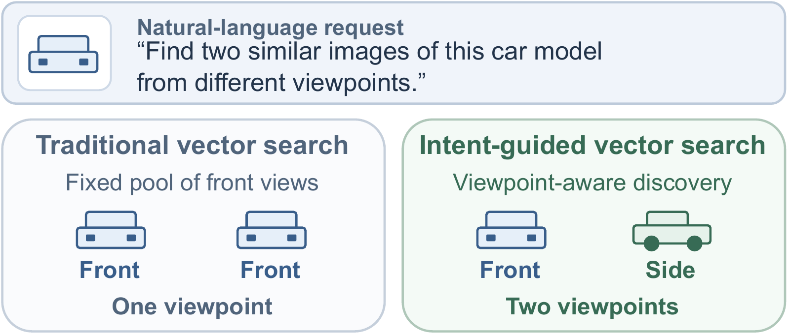</a>
</p>

The diagram illustrates a request, not a measured result. Natural-language
parsing is an optional upstream step. The reported benchmark uses frozen
structured plans, so it isolates retrieval from LLM accuracy and API latency.

## Install and try the integrated library

```bash
git clone https://github.com/AgentCombo/Violas.git
cd Violas
python -m benchmarks.current.run verify
```

Verification needs only Python's standard library. To execute the real
selector and HDMG on small synthetic cases, checked against exhaustive answers:

```bash
python -m venv .venv
source .venv/bin/activate
pip install -e .
python -m examples.intent_retrieval
python -m benchmarks.current.run demo
python -m benchmarks.current.run test
```

Full benchmarks target Linux/Python 3.12 and require prepared datasets,
vector caches and database collections. See [benchmark commands](benchmarks/current/README.md)
for dependencies and execution options.

## Typical Cases

These case studies illustrate entity consistency, diversity, linked evidence,
and cross-modal pairing. The current measured workloads and results are
described in [Experiments](#experiments).

### Entity Mismatch

Flat nearest-neighbor search can drift into a different semantic entity. Violas
routes by semantic entity first, then ranks local members.

#### Plausible Entity Mismatch

Some wrong neighbors are visually or textually plausible because they share
coarse traits with the query, but they still violate the intended entity.

<table>
  <tr>
    <td width="50%" align="center" valign="top">
      <a href="docs/figures/readme/case-1-1.jpg">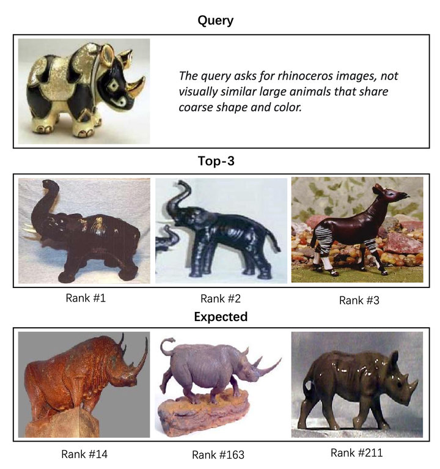</a><br>
      <sub>Rhinoceros: large-animal shape is not enough</sub>
    </td>
    <td width="50%" align="center" valign="top">
      <a href="docs/figures/readme/case-1-2.jpg">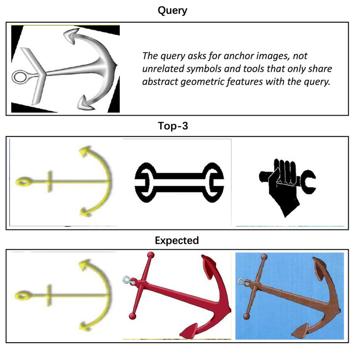</a><br>
      <sub>Anchor: abstract shape should not override entity meaning</sub>
    </td>
  </tr>
  <tr>
     <td width="50%" align="center" valign="top">
      <a href="docs/figures/readme/case-1-3.jpg">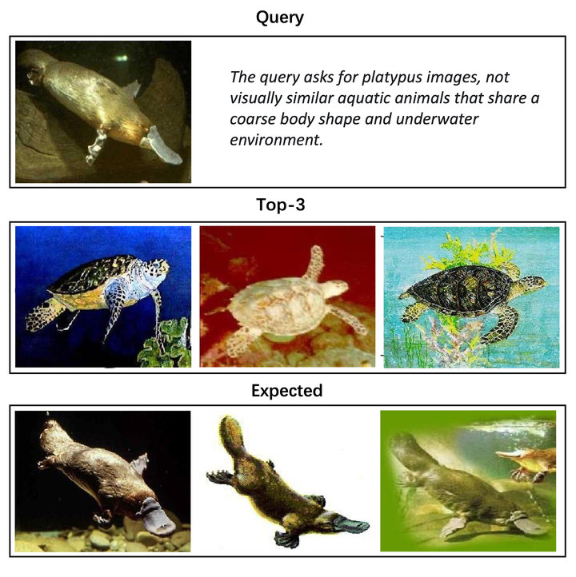</a><br>
      <sub>Platypus: coarse appearance is not enough</sub>
    </td>
    <td width="50%" align="center" valign="top">
      <a href="docs/figures/readme/case-1-4.jpg">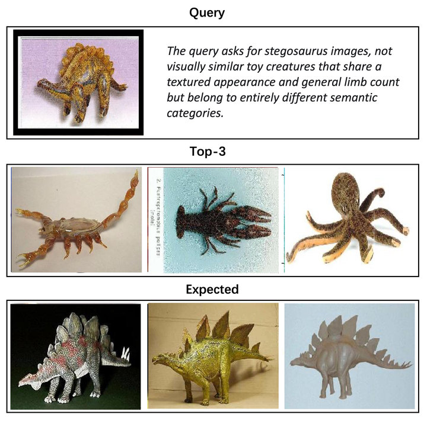</a><br>
      <sub>Stegosaurus: semantic identity should dominate</sub>
    </td>
  </tr>
</table>


#### Unjustified Entity Mismatch

Some nearest neighbors are embedding-close without a clear category-level or
visual relation to the query. These cases expose a stronger form of entity
mismatch than visually plausible drift.

<table>
  <tr>
    <td width="50%" align="center" valign="top">
      <a href="docs/figures/readme/case-2-1.jpg">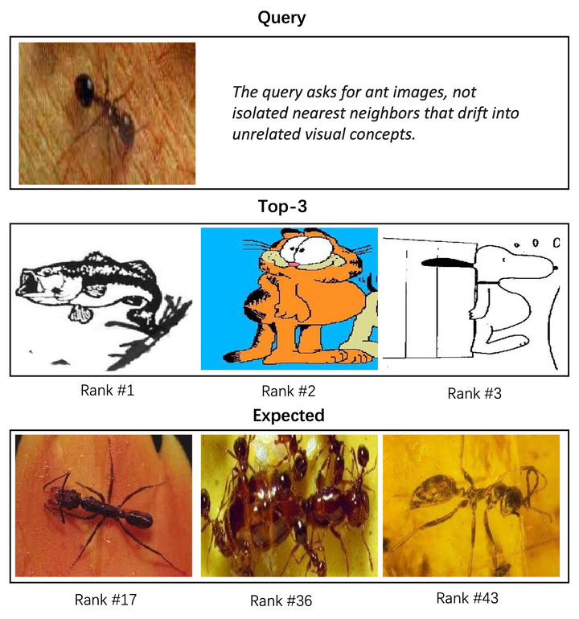</a><br>
      <sub>Ant: entity identity is not preserved</sub>
    </td>
    <td width="50%" align="center" valign="top">
      <a href="docs/figures/readme/case-2-3.jpg">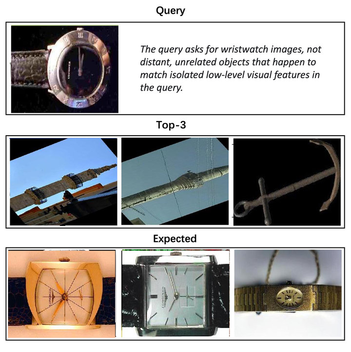</a><br>
      <sub>Wristwatch: embedding proximity is not enough</sub>
    </td>
  </tr>
</table>


### Diversity Loss

Even when the entity is correct, top results can be too redundant. Violas uses
representative local regions to expose different poses, viewpoints, chunks, or
scene layouts under the same semantic entity.

<table>
  <tr>
    <td width="50%" align="center" valign="top">
      <a href="docs/figures/readme/case-3-1.jpg">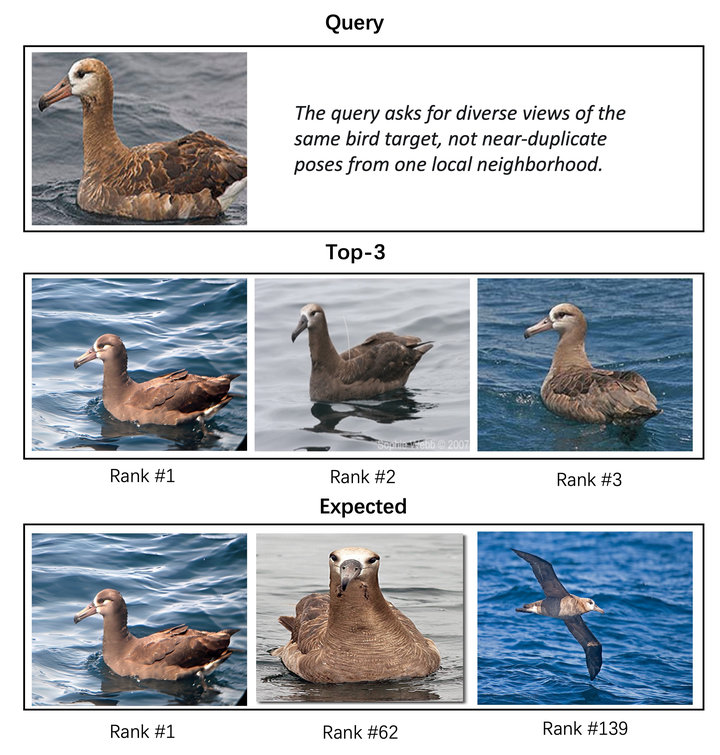</a><br>
      <sub>Bird: one entity, multiple useful views</sub>
    </td>
    <td width="50%" align="center" valign="top">
      <a href="docs/figures/readme/case-3-2.jpg">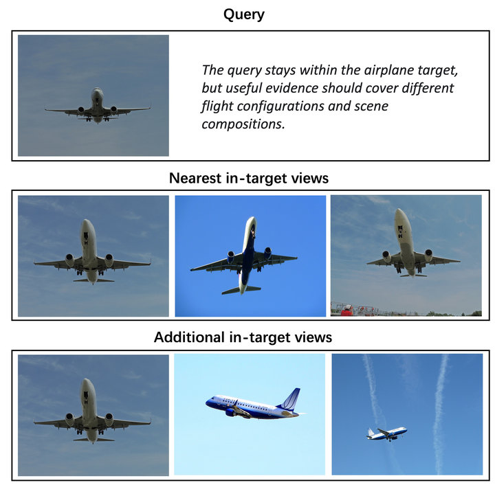</a><br>
      <sub>Airplane: cover flight configurations and scenes</sub>
    </td>
  </tr>
</table>


### Dependency Loss

Some useful answers require linked objects rather than a single nearest chunk.
In these OHSUMED cases, the middle segment is used as the query, while the
desired answer is the surrounding same-document evidence chain. Flat top-k
retrieval often returns isolated snippets that share surface vocabulary but
lose the dependency between setup, evidence, and conclusion.

<table>
  <tr>
    <td width="50%" align="center" valign="top">
      <a href="docs/figures/readme/case-5-1.jpg">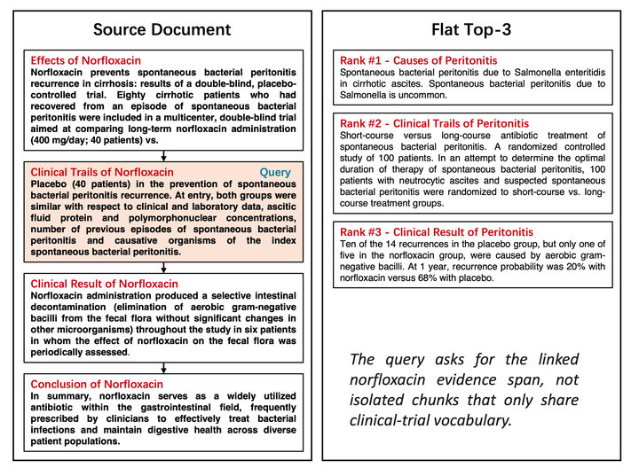</a><br>
      <sub>Norfloxacin: trial evidence should be retrieved as a chain</sub>
    </td>
    <td width="50%" align="center" valign="top">
      <a href="docs/figures/readme/case-5-2.jpg">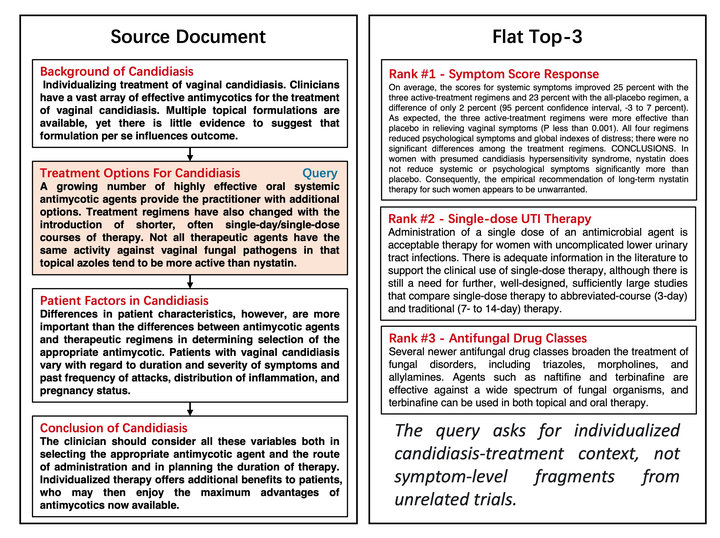</a><br>
      <sub>Candidiasis: treatment choices need patient context</sub>
    </td>
  </tr>
</table>


### Cross-Modal Evidence

Some retrieval tasks need paired evidence across modalities, such as a caption
and its corresponding image. Violas keeps these modality links inside the same
retrieval object instead of reconstructing them after a flat vector search.

<table>
  <tr>
    <td width="50%" align="center" valign="top">
      <a href="docs/figures/readme/case-4-1.jpg">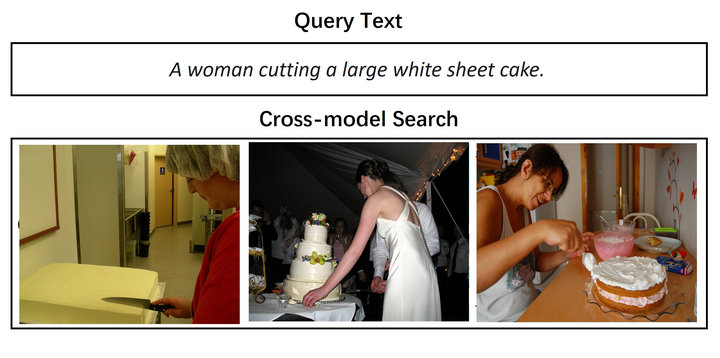</a><br>
      <sub>Sheet cake: text query aligned with image evidence</sub>
    </td>
    <td width="50%" align="center" valign="top">
      <a href="docs/figures/readme/case-4-2.jpg">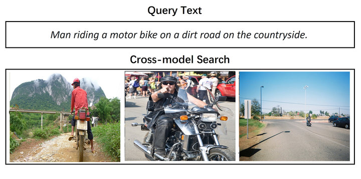</a><br>
      <sub>Motorbike: scene-level text and image agreement</sub>
    </td>
  </tr>
  <tr>
    <td width="50%" align="center" valign="top">
      <a href="docs/figures/readme/case-4-3.jpg">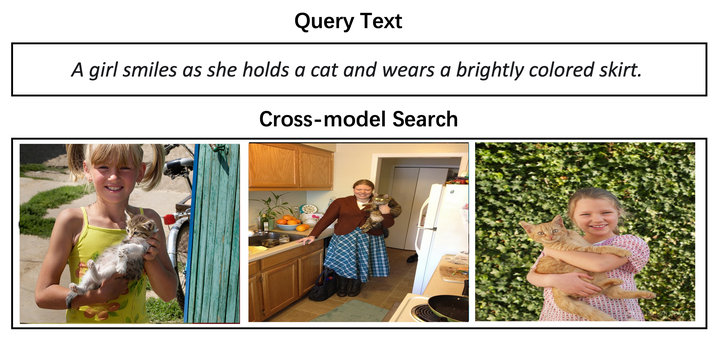</a><br>
      <sub>Girl with cat: paired visual and caption evidence</sub>
    </td>
    <td width="50%" align="center" valign="top">
      <a href="docs/figures/readme/case-4-4.jpg">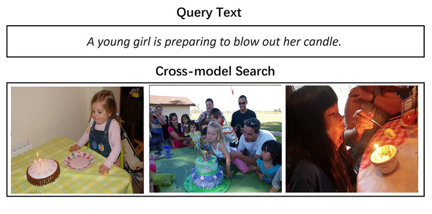</a><br>
      <sub>Candle: multimodal evidence keeps context intact</sub>
    </td>
  </tr>
</table>

## Data and query execution

<p align="center">
  <a href="docs/figures/current/Object-Matrix-ICDE-v6.png">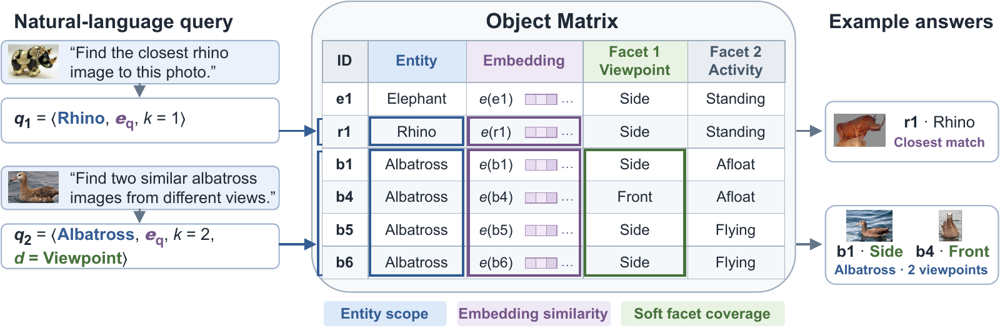</a>
</p>

Each object has an ID, embedding, entity and facet key/value metadata. Entity
entries point to disjoint geometric micro-clusters, which keep members and
summaries. Hard conditions identify eligible members; the conditional engine
uses center/member representatives, graph traversal and remaining category
reward to schedule scoring. Exact single-facet SELECT chooses the best set
within the retrieved candidates. A missing diversity preference reduces to
relevance selection.

<p align="center">
  <a href="docs/figures/current/Entity-Cell-Graph-ICDE-single.png">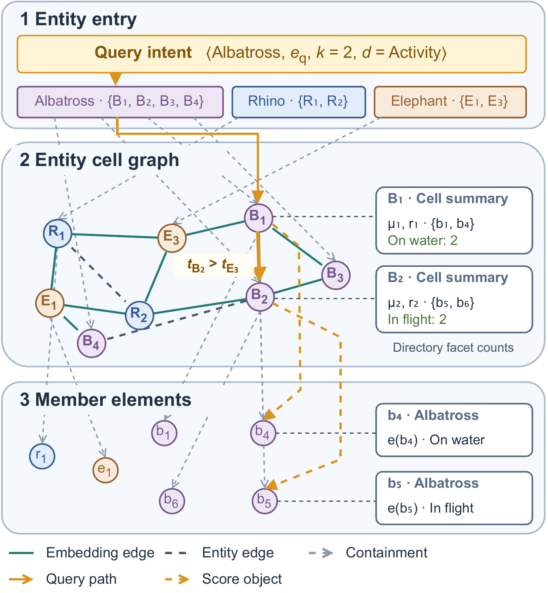</a>
</p>

The implementation builds geometric micro-clusters within each entity.
Facet postings and cell summaries support filtering and query navigation.

## Experiments

We evaluate six datasets with 100 fixed queries per dataset and top-3 answers,
comparing Violas with Milvus, Qdrant and Chroma.

**Conditional retrieval.** Violas achieves a mean objective ratio of
0.999972–1.000000 across the six datasets. The comparison covers all-match
prefiltering, ANN postfiltering and filtered ANN, using the same final selector.

<p align="center">
  <a href="docs/figures/current/rq2-tradeoff-20261111.png">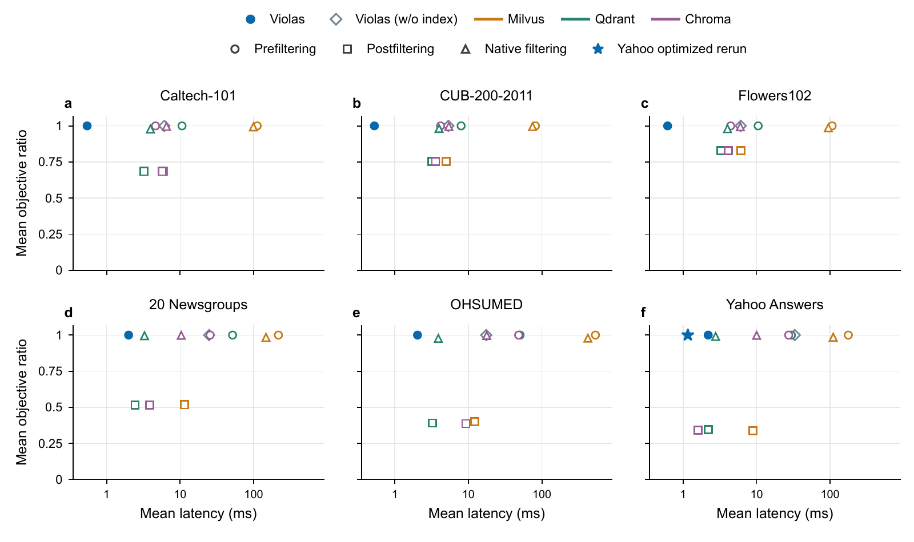</a>
</p>

**Pure embedding retrieval.** We report Recall@3 against exact cosine search
and query latency, without intent or facet selection.

<p align="center">
  <a href="docs/figures/current/rq3-embedding-20261111.png">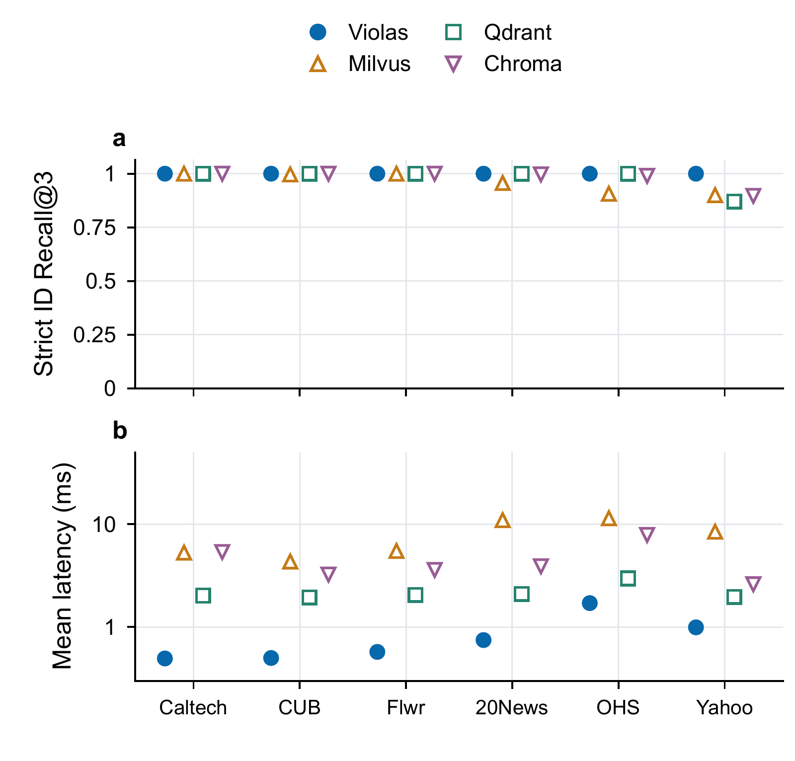</a>
</p>

**Build and CRUD.** Violas has the lowest recorded empty-to-ready build time
on these six datasets; individual CRUD operations vary by dataset and backend.

See [benchmark commands](benchmarks/current/README.md) to run the experiments.
The repository includes [fixed query plans](benchmarks/current/workloads/) and
[raw recorded results](benchmarks/current/results/) for checking the figures.

## Repository map

| Path | Purpose |
| --- | --- |
| `violas/retrieval/` | Integrated intent execution, SELECT, HDMG, summaries and incremental maintenance |
| `benchmarks/current/runtime/` | Experiment runners, VDB adapters and historical import compatibility |
| `benchmarks/current/run.py` | Explicit, tested artifact entry points |
| `benchmarks/current/results/` | Compressed per-query records and source hashes |
| `docs/figures/current/` | Supplied ICDE PDFs and direct PNG renders |
| `violas/storage/` | Existing VectorMap/VectorGroup storage and relation APIs |
| `benchmarks/caltech/`, etc. | Older benchmark pipelines, retained for compatibility |

The measured engine now lives in the installable `violas.retrieval` package.
Use `from violas import IntentIndex` for a query embedding plus a resolved plan;
see [the runnable example](examples/intent_retrieval.py) and [API](docs/api.md).
The benchmark imports this same core through thin compatibility aliases.
Existing `VectorMap.search_hdmg` and relation APIs retain their behavior.

## Reproducibility and license

Original source and result hashes, packaging edits, and actual validation
outcomes are recorded under `benchmarks/current/`. Replaying frozen plans does
not require an API key. Optional schema/intent generation reads credentials
from the environment. Raw datasets, API credentials, caches and database files
are not checked in. Code is released under [Apache-2.0](LICENSE).
